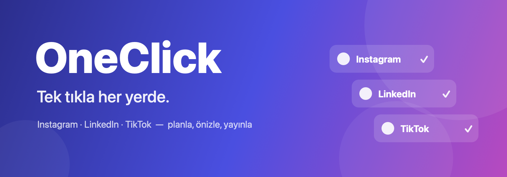
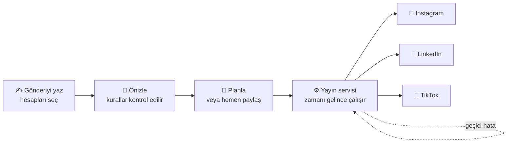

<p align="center">
  
</p>

<p align="center">
  <b>Instagram, LinkedIn ve TikTok hesaplarınızı tek panelden yönetin.</b><br>
  Bir kez yazın, hesapları seçin, takvimde planlayın. Zamanı gelince OneClick sizin yerinize paylaşır.
</p>

<p align="center">
  
  
  
  
  
</p>

---

## Neden OneClick?

Buffer, Later, Hootsuite gibi araçlar kullanıcı başına dolar bazlı aylık ücret ister, verilerinizi kendi sunucularında tutar ve arayüzleri Türkçe değildir. OneClick ise **sizin sunucunuzda** çalışır.

| | Hazır SaaS araçları | **OneClick** |
|---|---|---|
| Ücret | Kullanıcı ve hesap başına her ay, dolar bazlı | Tek seferlik kurulum. Kullanıcı ve hesap başına ücret yok. |
| Veriler | Üçüncü bir şirketin sunucusunda | **Sizin sunucunuzda**. Token'lar AES-256 ile şifreli saklanır. |
| Platform onayı | Aracın kendi uygulamasına bağlısınız | Kendi Meta, LinkedIn ve TikTok uygulamanızla çalışır. Kendi hesaplarınız için uygulama incelemesi (App Review) gerekmez. |
| Dil | Çoğunlukla İngilizce | Baştan sona Türkçe |
| Özelleştirme | Yok | Kaynak kod sizde. İstediğiniz gibi geliştirebilirsiniz. |

## Özellikler

### ✍️ Tek editör, her platform
- Gönderiyi bir kez yazın, birden fazla hesabı aynı anda seçin.
- **Hesap bazında özelleştirme:** her hesap için metni ayrı düzenleyin.
- **Gerçeğe yakın önizleme:** gönderinin her platformda nasıl görüneceğini yayınlamadan görün.
- **Platform kuralları anında kontrol edilir:** karakter sınırı, medya türü, oran ve süre hataları daha yayınlamadan gösterilir.
- Instagram'da **Gönderi, Reel, Hikâye ve Carousel**. TikTok'ta gizlilik, Duet/Stitch, yorum ve markalı içerik ayarları.

### 📅 Takvim ve zamanlama
- **Ay ve hafta görünümü**, hesap ve duruma göre filtreleme.
- Gönderiyi **sürükle-bırak** ile başka bir güne taşıyın.
- İster hemen paylaşın, ister ileri bir tarihe planlayın.

### 🔁 Yayın garanti altında
- Zamanı gelen gönderiler arka planda çalışan bir yayın servisi tarafından paylaşılır. Tarayıcınızın açık olması gerekmez.
- Geçici hatalarda (platform yoğunluğu, medya işleniyor) **otomatik tekrar deneme**.
- Kalıcı hatalarda platformun **orijinal hata mesajı** ve tek tıkla "Tekrar dene".
- **Çift paylaşım koruması:** tekrar denemede aynı gönderi iki kez yayınlanmaz.
- Yayınlanan her gönderi için **"Platformda aç"** bağlantısı.

### 🖼️ Medya kütüphanesi
- Görsel ve videoları bir kez yükleyin, tüm gönderilerde tekrar kullanın.
- Boyut, oran ve süre bilgisi otomatik çıkarılır.
- Yerel disk veya S3 uyumlu depolama (Cloudflare R2, Hetzner Object Storage, AWS S3).

### 👥 Ekip ve markalar
- **Workspace** yapısı: ajanslar her müşteri için ayrı alan açabilir.
- **Markalar:** hesapları markalara göre gruplayın.
- **Roller:** Sahip, Yönetici, Editör, Onaylayıcı, İzleyici.
- **Denetim kaydı:** hesap bağlama gibi kritik işlemler kim, ne zaman bilgisiyle kayıt altına alınır.

### 🔐 Güvenlik
- Platform token'ları veritabanında **AES-256-GCM** ile şifrelenir.
- Kısa ömürlü erişim token'ı ve yenileme token'ı ile oturum yönetimi.
- Süresi yaklaşan platform bağlantıları otomatik yenilenir. Yenilenemeyenler panelde "Yeniden bağla" olarak işaretlenir.

## Desteklenen platformlar

| Platform | Hesap türü | İçerik |
|---|---|---|
|  **Instagram** | Facebook Sayfasına bağlı Business / Creator | Gönderi, Carousel, Reel, Hikâye |
|  **LinkedIn** | Kişisel profil, şirket sayfası* | Metin, görsel, video |
|  **TikTok** | Kişisel / Creator | Video, fotoğraf |

<sub>* Şirket sayfaları için LinkedIn Community Management API onayı gerekir.</sub>

## Nasıl çalışır?



1. **Hesabı bağlayın.** Platformun kendi giriş ekranında izin verirsiniz. Şifreniz OneClick'e hiç gelmez.
2. **Gönderiyi hazırlayın.** Metin, medya, hesaplar ve platforma özel ayarlar tek ekranda.
3. **Planlayın.** Gönderi takvime düşer. Zamanı gelince yayın servisi her hesap için ayrı ayrı paylaşır ve sonucu kaydeder.

## Kurulum seçenekleri

OneClick abonelik usulü satılmaz. İki şekilde edinebilirsiniz:

| | **Kurulum hizmeti** | **Kaynak kod lisansı** |
|---|---|---|
| Kimler için | Teknik ekibi olmayan şirketler ve ajanslar | Kendi yazılım ekibi olan şirketler |
| İçerik | Sunucunuza kurulum, alan adı ve HTTPS, Meta / LinkedIn / TikTok uygulamalarınızın açılması, ilk hesapların bağlanması | Kaynak kodun tamamı ve kurulum dokümantasyonu |
| Sonrası | İsteğe bağlı yıllık bakım ve güncelleme | Kodu dilediğiniz gibi geliştirme hakkı |

**Sunucu maliyeti:** tek bir küçük bulut sunucusu yeter, örneğin Hetzner'de aylık yaklaşık €5–8. Bu maliyet kullanıcı veya hesap sayısıyla artmaz.

**Canlı demo** ve fiyat bilgisi için [GitHub üzerinden iletişime geçin](https://github.com/HalibrahimArslan).

---

<details>
<summary><b>🛠️ Teknik altyapı ve geliştirici kurulumu</b></summary>

## Teknik altyapı

```
apps/api        NestJS API + yayın worker'ı (aynı kod tabanı, iki ayrı süreç)
apps/web        React + Vite paneli
packages/shared Platform kuralları, doğrulama şemaları, ortak tipler
```

| Bileşen | Teknoloji |
| --- | --- |
| Panel | React 19, Vite, TanStack Query, Tailwind 4 |
| API | NestJS 11, Prisma, PostgreSQL |
| Kuyruk | Redis + BullMQ (zamanlanmış yayın, yeniden deneme, token yenileme) |
| Medya | Yerel disk (geliştirme) veya S3 uyumlu depolama |

## Yerel kurulum (macOS)

Gerekenler: Node 22, pnpm, Docker (OrbStack yeterli).

```bash
# 1) pnpm yoksa
corepack enable

# 2) Bağımlılıklar
pnpm install

# 3) Postgres ve Redis
docker compose up -d

# 4) Ortam değişkenleri
cp apps/api/.env.example apps/api/.env
#   JWT_SECRET ve ENCRYPTION_KEY için:
#   openssl rand -base64 48   → JWT_SECRET
#   openssl rand -base64 32   → ENCRYPTION_KEY

# 5) Veritabanı tabloları ve demo kullanıcı
pnpm --filter @oneclick/api exec prisma migrate dev
pnpm db:seed

# 6) Çalıştır (API :4000, worker, panel :5173)
pnpm dev
```

Tarayıcıda http://localhost:5173 adresini açın. Demo giriş: `demo@oneclick.local` / `demo12345`.

### İlk deneme: Mock platform

`.env` içinde `ENABLE_MOCK_PROVIDER=true` iken Hesaplar ekranında **Test (Mock)** kartı görünür. Gerçek platforma gitmeden akışın tamamını dener: bağlan → izin ver → gönderi oluştur → planla → worker yayınlar.

- Metne `#fail` yazarsanız yayın kalıcı hata verir (hata ekranı ve "Tekrar dene" denemesi için).
- `#flaky` yazarsanız ilk deneme geçici hata verir, worker 1 dakika sonra tekrar dener.

## Gerçek platformları bağlamak

Instagram ve TikTok, OAuth dönüş adresi için **HTTPS** ister. Ayrıca bu iki platform medyayı sizin sunucunuzdan **kendisi indirir**, bu yüzden API'nin internetten erişilebilir olması gerekir. Yerelde bunun en kolay yolu bir tünel:

```bash
brew install cloudflared
cloudflared tunnel --url http://localhost:4000
# verilen https://xxxx.trycloudflare.com adresini .env'e yazın:
#   API_PUBLIC_URL=https://xxxx.trycloudflare.com
#   PUBLIC_MEDIA_BASE_URL=https://xxxx.trycloudflare.com/media
```

Tünel adresi her açılışta değişir. Değiştiğinde `.env`'i ve platformlardaki dönüş adresini güncelleyin.

Her platformda kaydedilecek dönüş adresi: `{API_PUBLIC_URL}/v1/oauth/callback/{instagram|tiktok|linkedin}`

### Instagram (Facebook Login)

1. Instagram hesabını **Professional** (İşletme veya İçerik Üreticisi) yapın ve bir **Facebook Sayfasına** bağlayın.
2. https://developers.facebook.com → **Create app** → tür: **Business**. Kullanım durumu olarak **"Manage messaging & content on Instagram"** seçin.
3. **Kullanım durumları → Customize → API setup with Facebook login** bölümünde şu izinleri ekleyin: `instagram_basic`, `instagram_content_publish`, `pages_show_list`, `pages_read_engagement`, `business_management`.
4. **Facebook Login for Business → Settings → Valid OAuth Redirect URIs** alanına dönüş adresini girin.
5. Ana App ID ve App Secret'ı (`https://developers.facebook.com/apps/<APP_ID>/settings/basic/`) `.env` dosyasına yazın: `INSTAGRAM_APP_ID`, `INSTAGRAM_APP_SECRET`.

Uygulama geliştirme modunda kaldığı sürece App Review gerekmez. Uygulamada rolü olan (admin, geliştirici, tester) kişiler kendi hesaplarını bağlayabilir. Sayfa token'ı süresizdir. Görseller **JPEG**, en-boy oranı 4:5 ile 1.91:1 arası olmalıdır.

> Meta güvenlik kontrolünde "bir sorun oluştu" hatası alırsanız Facebook'ta Sayfa profilinden **kişisel profilinize** geçip tekrar deneyin.

### TikTok

1. https://developers.tiktok.com → **Manage apps → Connect an app**.
2. **Login Kit** ve **Content Posting API** ürünlerini ekleyin. Content Posting API'de **Direct Post**'u açın.
3. Login Kit'e dönüş adresini girin. **URL properties** bölümünde medya alan adınızı doğrulayın (PULL_FROM_URL için zorunlu).
4. **Sandbox** sekmesinde kullanıcının TikTok hesabını hedef kullanıcı olarak ekleyin.
5. `TIKTOK_CLIENT_KEY` ve `TIKTOK_CLIENT_SECRET` değerlerini `.env` dosyasına yazın.

> Önemli: TikTok, denetimden (audit) geçmemiş uygulamaların gönderilerini **yalnızca gizli (SELF_ONLY)** yayınlar ve hesabın gizli olmasını ister. Herkese açık paylaşım için uygulama TikTok'a denetime gönderilmeli.

### LinkedIn

1. https://www.linkedin.com/developers/apps → **Create app** (bir LinkedIn şirket sayfası ile ilişkilendirilir).
2. **Products** sekmesinde **Sign In with LinkedIn using OpenID Connect** ve **Share on LinkedIn** ekleyin (anında onaylanır).
3. **Auth** sekmesinde dönüş adresini ekleyin.
4. `LINKEDIN_CLIENT_ID` ve `LINKEDIN_CLIENT_SECRET` değerlerini `.env` dosyasına yazın.

Bu ayarlarla kişisel profilde paylaşım yapılır. **Şirket sayfasında** paylaşım için **Community Management API** başvurusu gerekir. Onaylandıktan sonra `LINKEDIN_ORGANIZATIONS_ENABLED=true` yapın ve hesabı yeniden bağlayın. Kullanıcının sayfada Admin veya Content Admin rolü olmalı.

LinkedIn token'ları yaklaşık 60 gün geçerlidir ve normal uygulamalar için otomatik yenilenemez. Süre dolunca hesap "Yeniden bağla" durumuna düşer.

## Mimari ayrıntılar

1. **Bağlama:** Panel `GET /v1/workspaces/:wid/accounts/connect/:platform` ile platformun izin sayfası adresini alır. Kullanıcı orada giriş yapıp izin verir, platform `/v1/oauth/callback/:platform` adresine döner. Token'lar AES-256-GCM ile şifrelenip saklanır.
2. **Gönderi:** Bir gönderi her hesap için bir `post_target` kaydına dönüşür. Böylece hesap bazında metin, ayar ve sonuç ayrı tutulur.
3. **Yayın:** Her hedef, zamanında çalışacak bir BullMQ işi olur. Worker token'ı gerekirse yeniler, platform adaptörünü çağırır, sonucu yazar.
   - Geçici hatalar (429, 5xx, medya işleniyor) 4 denemeye kadar üstel bekleme ile tekrar denenir.
   - Kalıcı hatalarda hedef "Başarısız" olur, panelden "Tekrar dene" yapılabilir.
   - Instagram container ve TikTok publish kimliği ara durum olarak saklanır. Yeniden denemede çift paylaşım yapılmaz.
4. **Bakım:** Worker her saat süresi yaklaşan token'ları yeniler, her dakika Redis'te kaybolmuş işleri yeniden kuyruğa alır.

## Komutlar

| Komut | İş |
| --- | --- |
| `pnpm dev` | API, worker ve paneli birlikte çalıştırır |
| `pnpm test` | Birim testleri |
| `pnpm typecheck` | Tip kontrolü |
| `pnpm build` | Üretim derlemesi |
| `pnpm --filter @oneclick/api exec prisma studio` | Veritabanını tarayıcıda gör |

## Üretim

`pnpm build` sonrası tek sunucuda çalıştırılabilir. API, `apps/web/dist` klasörünü kendisi sunar.

```bash
pnpm --filter @oneclick/api prisma:deploy
node apps/api/dist/main.js      # API + panel
node apps/api/dist/worker.js    # worker (ayrı süreç)
```

Üretimde `WEB_URL` ve `API_PUBLIC_URL` aynı alan adı olur. Medya için `STORAGE_DRIVER=s3` ve herkese açık bir bucket önerilir.

</details>

## Yol haritası

- [x] Hesap bağlama: Instagram, LinkedIn, TikTok
- [x] Editör, önizleme, platform kuralları
- [x] Takvim, zamanlı yayın, otomatik tekrar deneme
- [x] Medya kütüphanesi, workspace, marka ve roller
- [ ] Tek komutla kurulum (Docker + otomatik HTTPS)
- [ ] Beyaz etiket: kendi logonuz, adınız ve renkleriniz
- [ ] Onay akışı ve ekip davetleri
- [ ] Raporlar ve gönderi istatistikleri
- [ ] Birleşik gelen kutusu: yorum ve mesajlar tek ekranda

---

<p align="center">
  <sub>OneClick · Tek tıkla her yerde.</sub>
</p>
